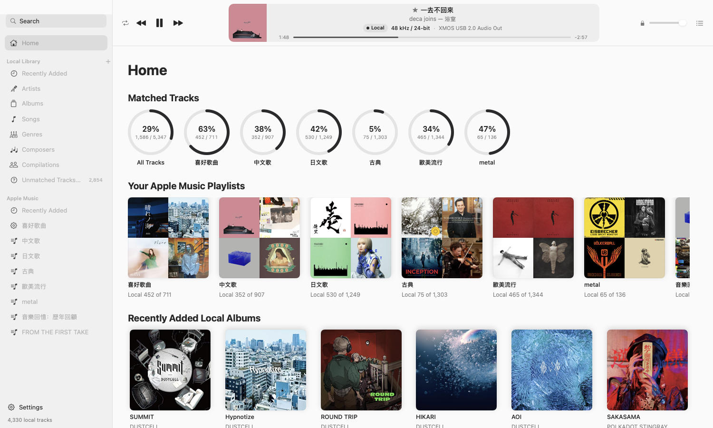
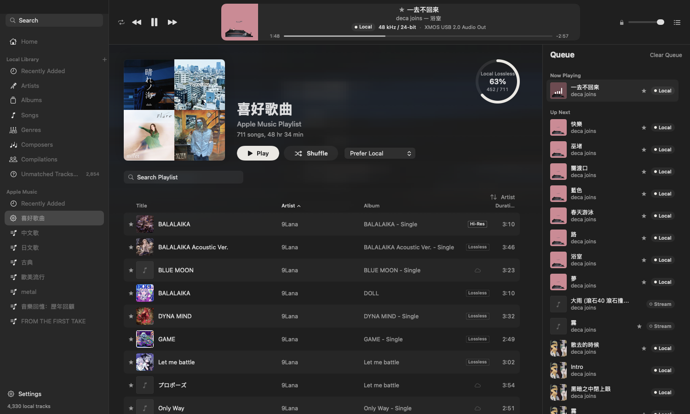
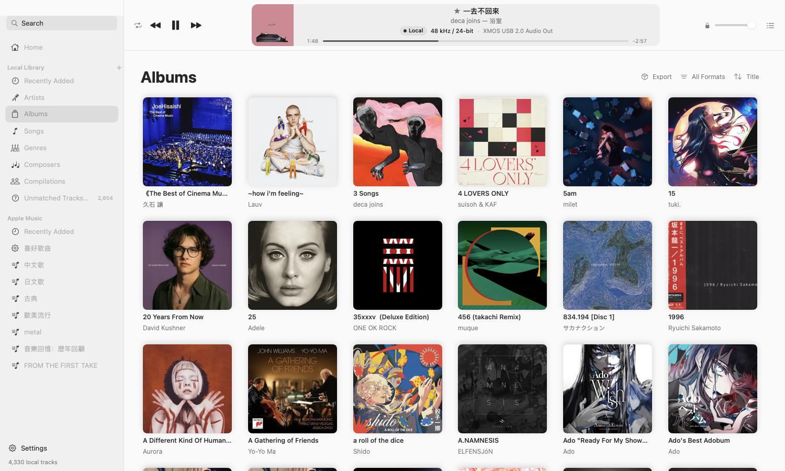
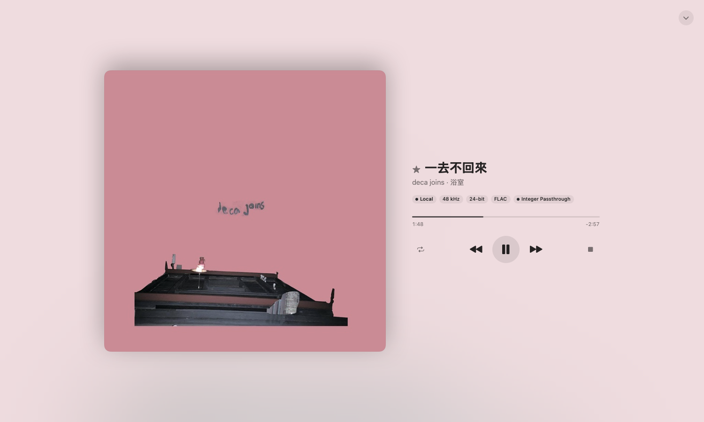
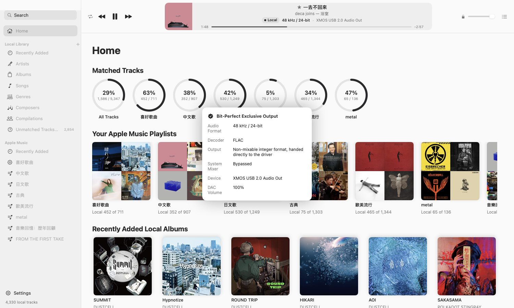
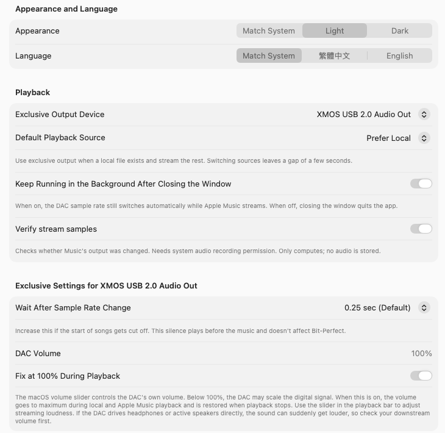
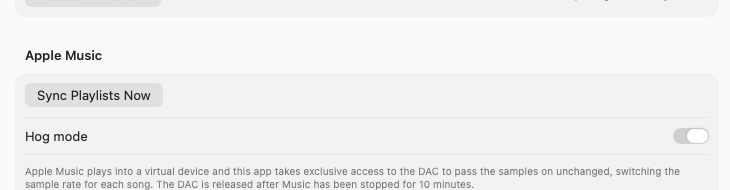

# LosslessCompanion

**English** | [繁體中文](README.zh-TW.md)


LosslessCompanion is a companion player for Apple Music on macOS. It puts your Apple Music playlists and the lossless files on your drive in one window:

- **Songs you have as local files** play in Bit-Perfect exclusive mode straight to your DAC, with an MD5 check after every track.
- **Songs that only exist on Apple Music** are played by Apple Music in the background, and the DAC's sample rate follows each song automatically.
- **Hog mode** sends Apple Music streams into the exclusively held DAC as well. In testing, a whole song came out sample-for-sample identical to the local FLAC, apart from Music's own fade-in at the start.
- **The inbox**: drop new songs into the Inbox folder inside your music folder. ALAC is converted to FLAC, tagged from Apple Music and filed into the right category automatically.

You can build and run it without a paid Apple Developer account.

## Screenshots

| Home | Playlist and queue |
|---|---|
|  |  |

| Albums | Player |
|---|---|
|  |  |

| Signal path | Settings |
|---|---|
|  |  |

## Requirements

- macOS 26 or later (tested on an Apple Silicon MacBook Air)
- The Apple Music app (streaming needs an Apple Music subscription with Lossless enabled in Music's settings)
- An external USB DAC (recommended; the built-in speakers work too)
- Xcode 26 to build

## Installation

### 1. Build the app

```bash
xcodebuild -project LosslessCompanion.xcodeproj -scheme LosslessCompanion -configuration Release -derivedDataPath /tmp/lc-build build
```

Then copy `/tmp/lc-build/Build/Products/Release/LosslessCompanion.app` to Applications or wherever you like.

Keep `-derivedDataPath` outside your Documents folder. Putting it inside the project has caused disk I/O errors in the build database.

### 2. Install the Bridge virtual device (only for Hog mode)

```bash
cd Driver
./build.sh                       # build and sign ad hoc
./install.sh                     # needs your admin password; restarts coreaudiod, so all audio stops for a few seconds
swiftc probe.swift -o probe && ./probe   # confirm the device loaded
```

This adds an output device called "LosslessCompanion Bridge". Installing it does not change your default output, and it never receives alert sounds. Hog mode makes it the default output only while bridging and switches back afterwards. Run `./uninstall.sh` to remove it. See [Driver/README.md](Driver/README.md) for details.

### 3. First launch

The logo appears first, then macOS asks for a few permissions. Allow all of them:

| Permission | Why |
|---|---|
| Control "Music" | Syncing playlists and playing streams |
| Documents folder | Reading your local library (`~/Documents/HI-RES` by default; change it in Settings) |
| Media & Apple Music | Reading the Music library |
| Microphone | Hog mode reads the input side of the Bridge virtual device. No real microphone is used and no audio is saved |
| System audio recording (optional) | "Verify stream samples" checks in the background whether Music's output was changed |

> **Notes**
> - The app is signed ad hoc, so macOS asks again after every rebuild.
> - If the app stays on "Scanning local files", the Documents prompt is usually still waiting for an answer. It may be hidden behind a full-screen app. You can also turn it on in System Settings › Privacy & Security › Files and Folders.
> - Without microphone permission, Hog mode stays off and Apple Music plays the usual way instead of going silent.

Data is stored in `~/Library/Application Support/LosslessCompanionHog`.

## Using the app

### Sidebar

- **Local Library**: Recently Added, Artists, Albums, Songs, Genres, Composers, Compilations, Unmatched Tracks/Albums, and Inbox. Grouping matches Apple Music. Songs matched to Music use Music's metadata; the rest use file tags.
- **Apple Music**: the 120 most recently added albums in your Music library, plus all your playlists.
- **Search**: looks through local files and the Music library at once, and matches both Traditional and Simplified Chinese.
- **The + next to Local Library**: creates a folder playlist. It only remembers the folder, so its contents follow your library.

### Playing

- Double-click a song, or use Play or Shuffle in the page header.
- **Playback source**: each playlist can be set to Prefer Local, Local Only or Apple Music Only. Right-click a song to play it from the other source just this once.
- The badge in the play bar shows the current source (Local or Stream), the format and the output device. Click it to open the signal path.
- Media keys and Control Center: the app takes over during local exclusive playback and hands them back to Apple Music when idle.

### Context menus

- Play Next, Add to Queue
- Go to Local Album, Go to Apple Music Album
- Show in Playlist: jumps from a streamed search result to the playlist that contains it and highlights the song
- Organize Files, Merge Albums, Create Folder Playlist, Export (albums)

### Queue

Open it with the list icon at the right of the play bar. It has three sections: Played, Now Playing and Up Next.

- Drag songs in Up Next to reorder them, or right-click to remove one.
- "Clear Queue" only removes Up Next; the current song keeps playing.
- Local songs with the same format are joined into one exclusive session and play gaplessly.

### Player

Click the artwork or title in the play bar. It shows only the current song, on top of the main window. Press Esc or the close button to dismiss it.

### Signal path

Click the format badge in the play bar:

- **Local playback**: source format, decoder, output format, whether system mixing is bypassed, device and DAC volume.
- **Apple Music streams**: codec, DAC format, volume, effects, device and interruptions. If anything would change the sound, a yellow warning appears in the play bar.

### Library tools

- **Unmatched Tracks/Albums**: local files that are not in your Music library. Review them one by one, link them manually, or mark them local-only.
- **Format filters**: filter albums, songs and artist pages by Hi-Res, sample rate, bit depth and file type.
- **Organize Files**: preview first, then rename files and write tags from Music's metadata. The audio data does not change by a single bit, and modification dates are kept.
- **Merge Albums**: show an album split across several folders as one, or actually move the files together.
- **Export**: zip the albums on the current page. Audio is not recompressed or converted.
- **Undo**: the last 30 organize and merge operations can be undone from Settings › Organize History.

### Inbox

The app creates a folder called 收件匣 (Inbox) inside your music folder (the first local folder in Settings, `~/Documents/HI-RES` by default). Put songs or whole album folders in it and the app will:

1. **Convert**: ALAC m4a files are converted with the built-in `afconvert` to FLAC at the same bit depth, carrying over tags, lyrics and artwork. The FLAC is compared with the original sample by sample, and only an exact match sends the original to the Trash. AAC is lossy, so converting it to FLAC would not improve the sound; it stays as m4a.
2. **Tag**: it looks in your Music library first, then in Apple's public iTunes Search API (this sends the title and artist name). The title, artist and length all have to match.
3. **File**: if the artist already has a folder, the song goes there. A new artist goes into the category for its genre, for example Anime and J-Pop into JPOP, Mandopop into CN & Indie Rock, Classical and Soundtrack into Classical & OST, and everything else into 西洋樂壇. Folders and file names follow the "Artist - Album (Year)/01 - Title" pattern.

Songs that match confidently are filed straight away. Songs that Apple Music cannot find, whose category was guessed, or whose destination already has a file with the same name are listed on the Inbox page in the sidebar, where you can edit the tags and category before filing. Filing is recorded in Organize History and can be undone; undone songs return to the inbox and wait for you to confirm. The inbox is not part of the library, so songs appear in albums and songs only after they are filed.

The inbox workflow is based on the music import steps of [NexTags](https://github.com/lumakes-apps/NexTags).

### Settings

Open Settings at the bottom left of the sidebar:

- **Local Music Folders**: add, remove, rescan.
- **Appearance and Language**: light/dark, Traditional Chinese/English (applies after relaunching).
- **Playback**: exclusive output device, default playback source, keep running in the background after closing the window, verify stream samples.
- **Exclusive settings per DAC**: the wait after a sample rate change (raise it if song starts get cut off), and whether to fix the DAC volume at 100% during playback.
- **Apple Music**: sync playlists now, Hog mode on/off.



## How Bit-Perfect playback works

### Local files

- The DAC is held exclusively (hog mode) in a non-mixable integer format, so samples go straight to the driver.
- Each playback session runs in a separate helper process, so the DAC is restored even if the app is force-quit.
- After every track the output samples are checked against an MD5, and FLAC files are also checked against their embedded MD5.

### Apple Music (normal mode)

The DAC's sample rate follows each song, and macOS converts Music's floating-point output to the DAC's format. That last step is done by the system and cannot be verified by the app.

### Apple Music (Hog mode)

1. Apple Music plays into the LosslessCompanion Bridge virtual device.
2. The app holds the physical DAC exclusively and passes the samples from the Bridge on unchanged.
3. The Bridge's clock follows the DAC, so the two stay phase-locked and no samples are added or dropped. Over 10 minutes the largest error measured was 1 sample.
4. Music's floating-point output differs from the original integers by only a few units in the last place (below about −140 dB). Rounding to the source's bit depth restores the original values exactly.

Measured: Apple Music playing 大風吹 (ALAC 16-bit/44.1 kHz) reached the DAC sample-for-sample identical to the local FLAC, apart from the fade-in at the start. When the next song was 48 kHz/24-bit, the bridge switched automatically.

**Known limitations**

- Music fades in every time you press play, so that short opening never matches the original file.
- If you press play in Music itself, about the first 0.4 seconds go straight to the DAC before the bridge takes over. Songs started from the app do not have this problem.
- While bridging, sounds from other apps are mixed into the Bridge too.
- During local exclusive playback macOS may move the default output to the Bridge, so alert sounds are not heard during that time.
- The app releases the DAC after Music has been stopped for 10 minutes.

## Development

```bash
xcodebuild test -project LosslessCompanion.xcodeproj -scheme LosslessCompanion -destination 'platform=macOS,arch=arm64' -derivedDataPath /tmp/lc-dd
```

There are about 430 unit tests. Every playback test uses fake transports and never touches Music or an audio device.

```
LosslessCompanion/
  App/          entry point, settings, debug preview and command tools
  Engine/       Bit-Perfect exclusive output, helper processes, Hog mode bridge (StreamBridge.swift)
  Library/      local scanning, artwork, matching, review, file organizing
  AppleMusic/   AppleScript, playlist sync, sample rate switching, stream checks
  Playback/     playback coordinator and transports
  UI/           interface
LosslessCompanionTests/   unit tests
Driver/         LosslessCompanion Bridge virtual audio device (adapted from BlackHole)
Tools/          measurement tools for clock drift, clock locking, bridging and sample comparison
docs/           documentation images and development notes
```

The interface is written in Traditional Chinese first. English translations are in `LosslessCompanion/Localizable.xcstrings` and permission prompts in `InfoPlist.xcstrings`. Development notes and verification records (in Chinese) are in [docs/DEVELOPMENT.zh-TW.md](docs/DEVELOPMENT.zh-TW.md).

### Measurement tools

Build the tools in `Tools/` with `swiftc -O <name>.swift -o <name>`. The tools that talk to a DAC have its UID at the top of the file; change it to your own device.

| Tool | Purpose |
|---|---|
| `drift` | Measures the clock difference between the Bridge and the DAC (ppm) |
| `clocklock` | Makes the Bridge clock follow the DAC and reports the phase error |
| `bridge` | A standalone bridge that can record the samples sent to the DAC |
| `feed` | Writes a file straight into the Bridge, bypassing Music |
| `compare` | Compares a recording with the original file sample by sample |

## Relationship with LosslessSwitcher

The exclusive output engine and the player card come from [LosslessSwitcher](https://github.com/vincentneo/LosslessSwitcher). This app also handles sample rate switching and detects when Music gets stuck, so you do not need LosslessSwitcher while it is running. If LosslessSwitcher is running, this app leaves stream sample rate switching to it.

## License and credits

This project is licensed under the [GNU General Public License v3.0](LICENSE).

- [LosslessSwitcher](https://github.com/vincentneo/LosslessSwitcher) by Vincent Neo, GPL-3.0: the source of the exclusive output engine and the player card.
- [BlackHole](https://github.com/ExistentialAudio/BlackHole) by Existential Audio, GPL-3.0: the source of the Bridge virtual device. Its original license is in `Driver/LICENSE-BlackHole`.
- [NexTags](https://github.com/lumakes-apps/NexTags), MIT: the inbox's convert, tag and file workflow is based on its import steps.

Powered by Talon and Claude.
