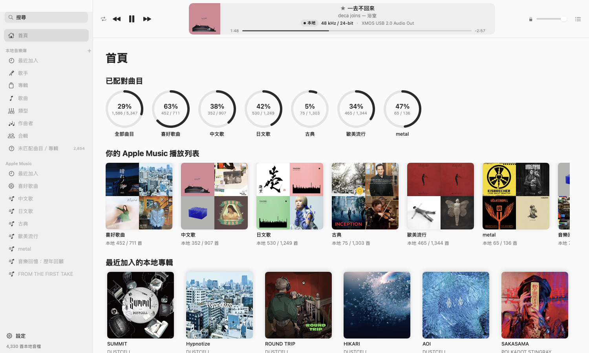
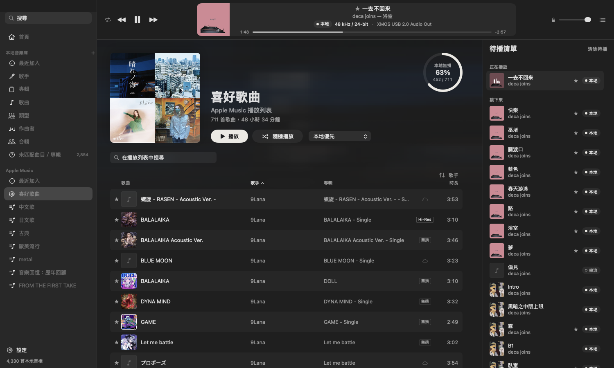
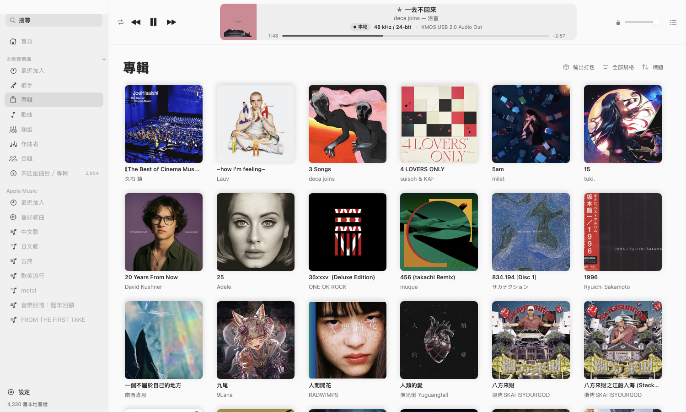
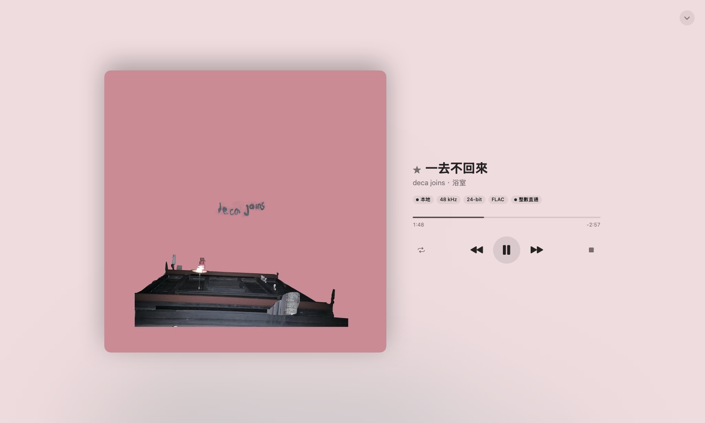
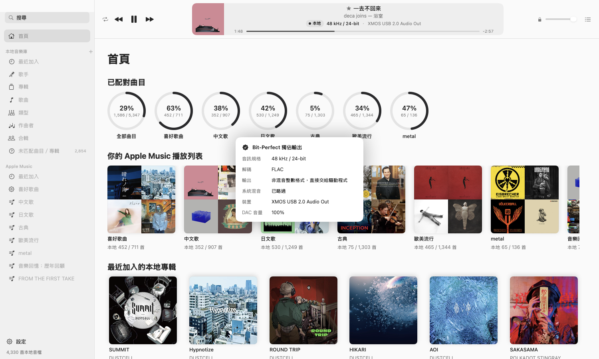
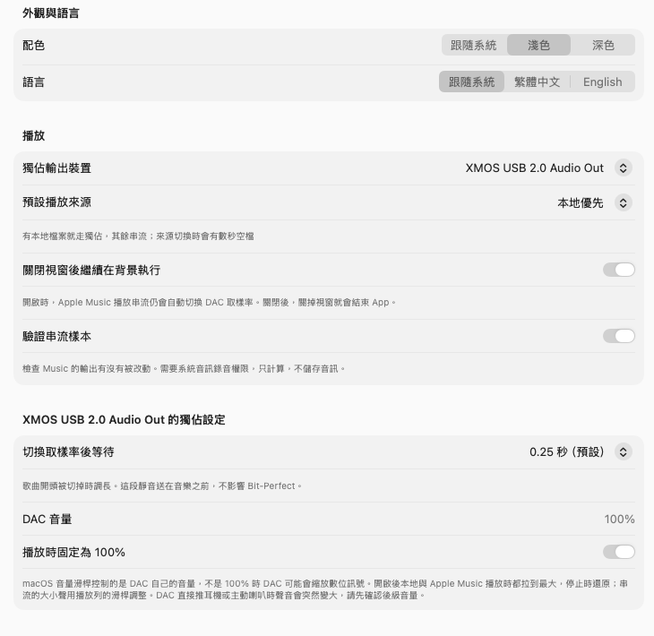
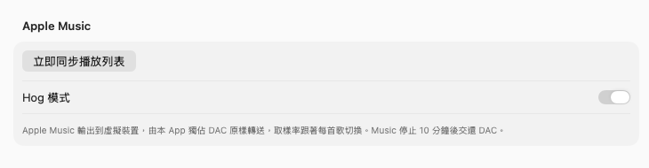

# LosslessCompanion

[English](README.md) | **繁體中文**


LosslessCompanion 是 macOS 上 Apple Music 的伴生播放器。它把你的 Apple Music 播放列表和硬碟上的無損音檔放在同一個介面裡：

- **有本地檔案的歌**：以 Bit-Perfect 獨佔模式直接送到 DAC，每首播完都比對 MD5。
- **只有串流的歌**：交給在背景執行的 Apple Music 播放，DAC 的取樣率會自動跟著每首歌切換。
- **Hog 模式**：Apple Music 的串流也能送進獨佔的 DAC。實測整首歌和本地 FLAC 逐樣本相同（Music 開頭的淡入除外）。

不需要付費的 Apple Developer 帳號，自己建置就能使用。

## 畫面

| 首頁 | 播放列表與待播清單 |
|---|---|
|  |  |

| 專輯 | 播放視窗 |
|---|---|
|  |  |

| 訊號路徑 | 設定 |
|---|---|
|  |  |

## 系統需求

- macOS 26 或更新版本（在 Apple Silicon 的 MacBook Air 上測試）
- Apple Music App（串流需要 Apple Music 訂閱，並在 Music 的設定裡開啟無損音質）
- 外接 USB DAC（建議；內建喇叭也能播放）
- 建置需要 Xcode 26

## 安裝

### 1. 建置 App

```bash
xcodebuild -project LosslessCompanion.xcodeproj -scheme LosslessCompanion -configuration Release -derivedDataPath /tmp/lc-build build
```

完成後把 `/tmp/lc-build/Build/Products/Release/LosslessCompanion.app` 複製到「應用程式」或任何你想放的地方。

`-derivedDataPath` 請放在「文件」資料夾以外，放在專案內曾出現建置資料庫的磁碟 I/O 錯誤。

### 2. 安裝 Bridge 虛擬裝置（Hog 模式才需要）

```bash
cd Driver
./build.sh                       # 建置並 ad-hoc 簽章
./install.sh                     # 需要管理員密碼；會重啟 coreaudiod，所有聲音中斷幾秒
swiftc probe.swift -o probe && ./probe   # 確認裝置已載入
```

安裝後系統會多一個名為「LosslessCompanion Bridge」的輸出裝置。安裝不會改變預設輸出，它也不會接收系統提示音。只有 Hog 模式橋接時才會暫時設成預設輸出，結束後自動改回。要移除時執行 `./uninstall.sh`。詳見 [Driver/README.zh-TW.md](Driver/README.zh-TW.md)。

### 3. 第一次開啟

開啟時會先顯示標誌，接著 macOS 會詢問幾項權限，請都按「允許」：

| 權限 | 用途 |
|---|---|
| 控制「音樂」 | 同步播放列表、播放串流 |
| 「文件」檔案夾 | 讀取本地音樂庫（預設是 `~/Documents/HI-RES`，可在設定裡更改） |
| 媒體與 Apple Music | 讀取 Music 資料庫 |
| 麥克風 | Hog 模式讀取 Bridge 虛擬裝置的輸入端。不會用到真正的麥克風，也不儲存音訊 |
| 系統音訊錄音（選用） | 「驗證串流樣本」在背景檢查 Music 的輸出有沒有被改動 |

> **注意**
> - App 是 ad-hoc 簽章，每次重新建置後 macOS 都會再問一次。
> - 如果畫面一直停在「正在掃描本地音檔」，通常是「文件」的詢問視窗還沒回答。它可能被全螢幕的 App 擋住，也可以到「系統設定 › 隱私權與安全性 › 檔案與檔案夾」直接打開。
> - 沒有給麥克風權限時，Hog 模式不會啟動，Apple Music 會改用一般方式播放，不會變成無聲。

資料存放在 `~/Library/Application Support/LosslessCompanionHog`。

## 使用方式

### 側欄

- **本地音樂庫**：最近加入、歌手、專輯、歌曲、類型、作曲者、合輯，以及「未匹配曲目／專輯」。分類方式和 Apple Music 相同。有配對到 Music 的歌曲用 Music 的資料，其餘用檔案標籤。
- **Apple Music**：Music 資料庫最近加入的 120 張專輯，以及你所有的播放列表。
- **搜尋**：同時找本地檔案與 Apple Music 資料庫，簡繁體都能找到。
- **側欄「本地音樂庫」旁的 +**：建立資料夾播放列表。播放列表只記住資料夾，內容會跟著音樂庫更新。

### 播放

- 雙擊歌曲，或按頁首的「播放」「隨機播放」。
- **播放來源**：每張歌單都能選「本地優先」「只播本地」「只用 Apple Music」。歌曲右鍵可以單首改用另一個來源。
- 播放列上的小標籤顯示目前的來源（本地或串流）、規格和輸出裝置。點一下會打開訊號路徑。
- 媒體鍵與控制中心：本地獨佔時由本 App 接手，閒置時交回 Apple Music。

### 右鍵選單

- 下一首播放、加入待播清單
- 前往本地專輯、前往 Apple Music 專輯
- 在播放列表中顯示：搜尋結果的串流歌曲可以跳到所在的歌單，並標出那一首
- 整理檔案、合併專輯、建立資料夾播放列表、輸出打包（專輯）

### 待播清單

按播放列右上角的清單圖示打開，分成「已播放」「正在播放」「接下來」：

- 接下來的歌可以拖曳調整順序，也可以右鍵移除。
- 「清除待播」只清掉接下來的歌，正在播放的不會中斷。
- 同規格的本地歌曲會接在同一段獨佔播放裡，無縫接續。

### 播放視窗

點播放列的封面或歌名打開，只顯示目前這首歌，蓋在主視窗上。按 Esc 或右上角關閉。

### 訊號路徑

點播放列的規格標籤打開：

- **本地播放**：顯示來源格式、解碼方式、輸出格式、是否略過系統混音、裝置與 DAC 音量。
- **Apple Music 串流**：顯示編碼、DAC 格式、音量、音效、裝置與中斷次數。有任何一項會改動聲音時，播放列會出現黃色警告。

### 本地音樂庫工具

- **未匹配曲目／專輯**：列出在 Music 資料庫找不到的本地檔案，可以逐首校閱、手動連結或標記為僅本地。
- **規格篩選**：專輯、歌曲與歌手頁可以依 Hi-Res、取樣率、位元深度、檔案類型篩選。
- **整理檔案**：先預覽，再用 Music 的資料改檔名與標籤。音訊資料一個位元都不會變，修改時間也保留。
- **合併專輯**：把分散在幾個資料夾的同一張專輯合併顯示，也可以選擇真的把檔案搬到一起。
- **輸出打包**：把目前頁面的專輯打包成 ZIP，音檔不壓縮也不轉檔。
- **復原**：整理與合併都能從「設定 › 檔案整理紀錄」復原最近 30 次。

### 設定

側欄左下角的「設定」：

- **本地音樂資料夾**：新增、移除、重新掃描。
- **外觀與語言**：淺色／深色、繁體中文／English（重新開啟 App 後套用）。
- **播放**：獨佔輸出裝置、預設播放來源、關閉視窗後是否繼續在背景執行、驗證串流樣本。
- **每台 DAC 的獨佔設定**：切換取樣率後的等待時間（歌曲開頭被切掉時調長），以及播放時是否把 DAC 音量固定為 100%。
- **Apple Music**：立即同步播放列表、Hog 模式開關。



## Bit-Perfect 的做法

### 本地檔案

- 獨佔（hog）DAC，切到不可混音的整數格式，樣本直接交給驅動程式。
- 每段播放在獨立的輔助程序裡執行，App 被強制結束時也會還原 DAC。
- 每首播完都比對輸出樣本的 MD5，FLAC 還會和檔案內建的 MD5 比對。

### Apple Music（一般模式）

DAC 的取樣率跟著每首歌切換，由系統把 Music 的浮點輸出轉成 DAC 的格式。這一段由 macOS 處理，App 無法驗證。

### Apple Music（Hog 模式）

1. Apple Music 輸出到 LosslessCompanion Bridge 虛擬裝置。
2. App 獨佔實體 DAC，把 Bridge 收到的樣本原封不動轉送過去。
3. Bridge 的時脈跟著 DAC 走，兩邊相位鎖住，不會多出或少掉樣本。實測 10 分鐘最大誤差 1 個樣本。
4. Music 輸出的浮點數和原始整數只差幾個最小單位（約 −140 dB 以下），四捨五入到來源的位元深度就還原成原樣。

實測：Apple Music 播放〈大風吹〉（ALAC 16-bit／44.1 kHz），送進 DAC 的樣本除了開頭淡入，其餘都和本地 FLAC 逐樣本相同。換到 48 kHz／24-bit 的下一首時，也會自動切換。

**已知限制**

- Music 每次按下播放都會淡入，開頭那一小段本來就和原檔不同。
- 直接在 Music 裡按播放時，開頭約 0.4 秒會在橋接接手前直接送到 DAC。從 App 播放沒有這個問題。
- 橋接時，其他 App 的聲音也會混進 Bridge。
- 本地獨佔播放時，macOS 可能把預設輸出移到 Bridge，這段時間聽不到系統提示音。
- Music 停止 10 分鐘後，App 會交還 DAC。

## 開發

```bash
xcodebuild test -project LosslessCompanion.xcodeproj -scheme LosslessCompanion -destination 'platform=macOS,arch=arm64' -derivedDataPath /tmp/lc-dd
```

單元測試約 400 項，播放流程全部使用假的傳輸層，不會碰到 Music 或音訊裝置。

```
LosslessCompanion/
  App/          進入點、設定、Debug 用的預覽與指令工具
  Engine/       Bit-Perfect 獨佔輸出、輔助程序、Hog 模式橋接（StreamBridge.swift）
  Library/      本地掃描、封面、比對、校閱、檔案整理
  AppleMusic/   AppleScript、歌單同步、取樣率切換、串流檢查
  Playback/     播放協調與傳輸層
  UI/           介面
LosslessCompanionTests/   單元測試
Driver/         LosslessCompanion Bridge 虛擬音訊裝置（BlackHole 改寫）
Tools/          時脈漂移、時脈鎖定、橋接與逐樣本比對的量測工具
docs/           說明文件圖片與開發紀錄
```

介面文字以繁體中文為原文，英文翻譯在 `LosslessCompanion/Localizable.xcstrings`，權限提示在 `InfoPlist.xcstrings`。開發過程與驗證紀錄見 [docs/DEVELOPMENT.zh-TW.md](docs/DEVELOPMENT.zh-TW.md)。

### 量測工具

`Tools/` 裡的工具用 `swiftc -O <名稱>.swift -o <名稱>` 建置。會用到 DAC 的工具把它的 UID 寫在檔案開頭，請改成你自己的裝置。

| 工具 | 用途 |
|---|---|
| `drift` | 量 Bridge 和 DAC 的時脈差（ppm） |
| `clocklock` | 讓 Bridge 時脈跟著 DAC，回報相位誤差 |
| `bridge` | 獨立版的橋接，可以把送給 DAC 的樣本錄下來 |
| `feed` | 不經過 Music，直接把音檔寫進 Bridge |
| `compare` | 把錄到的樣本和原始音檔逐樣本比對 |

## 和 LosslessSwitcher 的關係

本 App 的獨佔輸出引擎與播放視窗源自 [LosslessSwitcher](https://github.com/vincentneo/LosslessSwitcher)，並已包含取樣率切換與 Music 卡死偵測，開著本 App 就不需要再執行 LosslessSwitcher。LosslessSwitcher 正在執行時，本 App 會把串流的取樣率切換交給它。

## 授權與致謝

本專案以 [GNU General Public License v3.0](LICENSE) 授權。

- [LosslessSwitcher](https://github.com/vincentneo/LosslessSwitcher)，作者 Vincent Neo，GPL-3.0：獨佔輸出引擎與播放卡片的來源。
- [BlackHole](https://github.com/ExistentialAudio/BlackHole)，作者 Existential Audio，GPL-3.0：Bridge 虛擬裝置的原始碼，原授權見 `Driver/LICENSE-BlackHole`。

Powered by 三彈瓦斯 and Claude.
